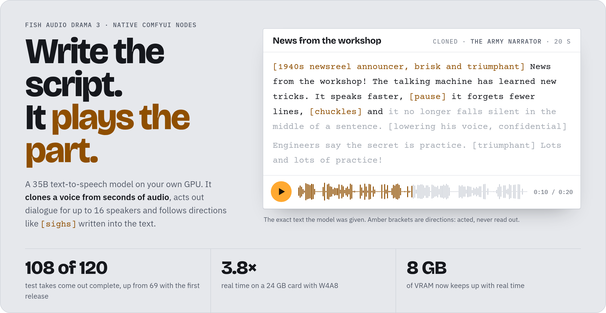
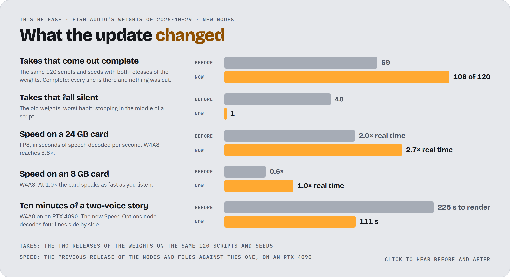
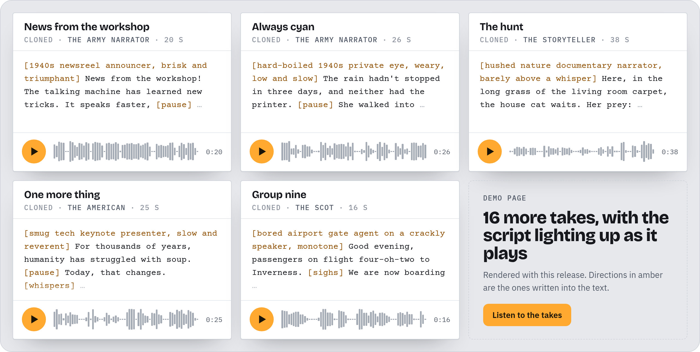

<p><a href="https://pedromarinhodev.github.io/ComfyUI-Drama3/"><picture><source media="(prefers-color-scheme: dark)" srcset="assets/hero-dark.png"></picture></a></p>

**ComfyUI-Drama3** runs [Fish Audio Drama 3](https://huggingface.co/fishaudio/drama-3), a 35B text-to-speech model,
natively in ComfyUI. Clone a voice from a few seconds of audio, cast up to 16 speakers in one script and write
directions such as `[sighs]` or `[whispers]` where they should land. It runs on NVIDIA cards from 8 GB, with nothing
to `pip install`.

[Listen on the demo page](https://pedromarinhodev.github.io/ComfyUI-Drama3/) ·
[Weights on Hugging Face](https://huggingface.co/PedroMarinhoDev/Drama-3-ComfyUI) ·
[Quick start](#quick-start) ·
[Reference](docs/REFERENCE.md)

## What's new

Fish Audio retrained Drama 3's weights on 2026-10-29. With them, 108 of 120 test takes come out complete, up from
69. The small files are now tuned on the model's own speech, decoding is faster on every card, long scripts render twice as fast with
lines at once, and `voice_guidance` keeps two voices apart in a dialogue whose lines hear each other.

<p><a href="https://pedromarinhodev.github.io/ComfyUI-Drama3/#update"><picture><source media="(prefers-color-scheme: dark)" srcset="assets/update-dark.png"></picture></a></p>

> [!IMPORTANT]
> **Updating?** Update the nodes first, then download a model file again. Older nodes refuse the new files with
> `unexpected ['line_head.weight']`. The first release's files moved to
> [`v1/`](https://huggingface.co/PedroMarinhoDev/Drama-3-ComfyUI/tree/main/v1) and still load in the new nodes.
> Saved voices keep working, and the codec file is unchanged.

## Listen

<p><a href="https://pedromarinhodev.github.io/ComfyUI-Drama3/#listen"><picture><source media="(prefers-color-scheme: dark)" srcset="assets/takes-dark.png"></picture></a></p>

The cloned voices come from two public-domain films of 1948 and 1954 with uncredited narrators, and from open speech
corpora recorded for research by anonymous volunteers (CSTR VCTK and Google FLEURS, CC BY 4.0). The demo page credits
each one; the other voices are invented by the model.

## Quick start

**1. Install the nodes** and restart ComfyUI. Search for **Drama 3 text to speech** in ComfyUI-Manager, or run
`comfy node install drama3`, or clone the repository:

```bash
cd ComfyUI/custom_nodes
git clone https://github.com/PedroMarinhoDev/ComfyUI-Drama3
```

**2. Download a model file, the codec and Qwen3-ASR**, which writes the transcripts of voice clips. From the
`ComfyUI` folder:

```bash
hf download PedroMarinhoDev/Drama-3-ComfyUI drama3_fp8experts_bf16.safetensors --local-dir models/diffusion_models
hf download PedroMarinhoDev/Drama-3-ComfyUI drama3_codec.safetensors --local-dir models/vae
hf download PedroMarinhoDev/Qwen3-ASR-ComfyUI qwen3_asr_1.7b_bf16.safetensors --local-dir models/asr
```

Swap the first file for a smaller one from [Which file](#which-file) if your card or RAM is smaller.

**3. Open a workflow and queue.** Drag [`drama3_voice_clone.json`](example_workflows/drama3_voice_clone.json) into
ComfyUI, pick a clip of clean speech in **Load Reference Audio**, write your text in **Drama 3 Generate** and run.
[`drama3_text_to_speech.json`](example_workflows/drama3_text_to_speech.json) needs no clip: the model makes up a voice.

To keep a voice, unmute **Save Drama 3 Voice**. It writes the encoded voice, a few KB, to `output/drama3_voices`, and
**Load Drama 3 Voice** brings it back without the clip.

## Which file

All four model files hold the whole model and complete the same share of our test takes. They differ in how the
routed experts, 90% of the model, are stored. Speed is seconds of speech per second on an RTX 4090, so 1.0× is real
time. The 12 GB and 8 GB columns ran with the rest of the card held by another process.

| File | Pick it for | Size | System RAM | 24 GB | 12 GB | 8 GB |
|---|---|---|---|---|---|---|
| [`drama3_fp8experts_bf16`](https://huggingface.co/PedroMarinhoDev/Drama-3-ComfyUI/blob/main/drama3_fp8experts_bf16.safetensors) | Fish Audio's own expert weights, on a 24 GB card | 38.6&nbsp;GB | ~48 GB | 2.7× | 1.0× | 0.6× |
| [`drama3_int8experts_bf16`](https://huggingface.co/PedroMarinhoDev/Drama-3-ComfyUI/blob/main/drama3_int8experts_bf16.safetensors) | The same quality on a smaller card | 38.7&nbsp;GB | ~48 GB | 2.7× | 1.5× | 0.9× |
| [`drama3_w6a8experts_bf16`](https://huggingface.co/PedroMarinhoDev/Drama-3-ComfyUI/blob/main/drama3_w6a8experts_bf16.safetensors) | 6 GB smaller than FP8, almost as close to it as int8 | 32.7&nbsp;GB | ~40 GB | 3.2× | 1.3× | 0.7× |
| [`drama3_w4a8experts_bf16`](https://huggingface.co/PedroMarinhoDev/Drama-3-ComfyUI/blob/main/drama3_w4a8experts_bf16.safetensors) | The fastest on any card, or 32 GB of RAM | 24.6&nbsp;GB | ~32 GB | **3.8×** | **2.0×** | **1.0×** |

You also need ComfyUI v0.40 or newer and about 1.6 GB for the codec. Quality and speed measurements are in the
[reference](docs/REFERENCE.md#speed).

## Writing a script

Directions are free natural language, so any wording works. Fish Audio's
[technical report](https://github.com/fishaudio/fish-speech/blob/main/docs/assets/Fish_Audio_Drama_3_Technical_Report.pdf)
(Appendix C) has the full syntax.

```text
<|speaker:0|> [whispering] Don't move. I think it heard us.
<|speaker:1|> [laughs] It's only the cat. <whisper>Your face, though.</whisper>
<|speaker:0|> [sighs] Fine. You win.
```

| Write | To |
|---|---|
| `<\|speaker:N\|>` at the start of a line, N from 0 to 15 | Give a line to a speaker |
| `[sighs]`, `[laughs]`, `[pause]` | Put a sound or pause exactly there |
| `<whisper>...</whisper>` | Shape only the words inside |
| `[with bright eager excitement]` at the start of a line | Set the delivery of the whole line |
| `Direction: icy calm.` then `Line: So this is goodbye.` | Give a director's note |
| `[language: pt]` after a line | Hint the language; it is not spoken |

Text in round parentheses is spoken. The model copies the reference clip's delivery: a flat clip gives a flat take.

## Dialogue

The voice in Generate's slot `voiceN` speaks for `<|speaker:N|>`; a speaker without a voice gets one the model makes
up. `speakers` on **Drama 3 Generate** sets how the lines are generated:

| `speakers` | How it generates | Voices stay apart | Lines react |
|---|---|---|---|
| **one take per line** (default) | Each line on its own | yes | no |
| **one take per line, hearing the line before** | Each line hears the take before it | the second voice can drift, unless guided | yes |
| **one take per speaker** | All of a speaker's lines in one take, put back in script order | yes | no |
| **together** | One take in which every line hears the others | voices can blend, unless guided | yes |

In those two modes, with a voice for every speaker, `voice_guidance` 1.0 on **Drama 3 Generate** keeps the voices
apart, at about twice the render time for those takes.

For a long script in **one take per line**, add **Drama 3 Speed Options** with `lines_at_once` 4: a ten-minute
two-voice story renders in 111 s instead of 225 s. It is off by default because it changes what a seed generates.

## Troubleshooting

<details>
<summary><b>"unexpected ['line_head.weight']" when loading a model file</b></summary>

The file is from the 2026-10-29 weights and the nodes are older. Update the nodes and restart ComfyUI.

</details>

<details>
<summary><b>A take falls silent after a second, or speaks only part of the text</b></summary>

Use a file of the 2026-10-29 weights and set `top_k` to 0: workflows saved before that fix keep the old 30. Then
check the voice: the transcript must cover every word of the clip, and the clip should be clean speech cut between
sentences. Load Reference Audio cuts at a pause and Qwen3-ASR writes the transcript, so the two match. A new seed
usually helps too.

</details>

<details>
<summary><b>Speakers swap or blend voices in a dialogue</b></summary>

Give every speaker a voice and use **one take per line**, where voices cannot reach each other. To keep the lines
reacting to each other, use **hearing the line before** or **together** with `voice_guidance` 1.0, at about twice the
render time.

</details>

<details>
<summary><b>Out of memory, or the first run takes minutes</b></summary>

Lower `expert_cache_gb` on **Load Drama 3**, or pick a smaller file if system RAM is the limit. The first run reads
the whole model file from disk once; later runs start in seconds. Pinning is not a way out: pinned experts cost the
same system RAM as unpinned ones, only locked.

</details>

<details>
<summary><b>`voice_guidance` or `lines_at_once` does nothing</b></summary>

Both decode a frame as one CUDA graph, which needs the experts pinned where the kernels can read them. ComfyUI's
`--disable-pinned-memory` does not decide that; `pin_experts` on **Load Drama 3** does, and Generate names what is
missing when it cannot batch. A cache holding under half the experts (int8 on a card under about 20 GB) leaves some
of them to the CPU, which also stops the batching: raise `expert_cache_gb` or pick a smaller file.

</details>

The [reference](docs/REFERENCE.md) has every node and setting, how the model fits on an 8 GB card, the full
measurements, how to build the files yourself and how close the port is to Fish Audio's code.

## License and credits

The code is under the [GNU GPL v3](LICENSE), except the parts ported from Fish Audio's code and Fish Audio's
tokenizer and config, which remain under the [Fish Audio Community License](LICENSE-FISH-AUDIO), and the parts
adapted from Qwen's `qwen-asr`, under the [Apache License 2.0](LICENSE-APACHE). [NOTICE](NOTICE) lists them.

> [!NOTE]
> Drama 3's weights and outputs fall under the Fish Audio Community License: free for research and non-commercial
> use, and for commercial use below USD 500k annual revenue; a hosted TTS service needs a license from Fish Audio.
> Don't clone the voice of an identifiable person without their consent.

**Built with Fish Audio.** Drama 3 and its codec are by [Fish Audio](https://fish.audio); Qwen3-ASR is by the
[Qwen team](https://github.com/QwenLM/Qwen3-ASR). This project is not affiliated with or endorsed by either.
